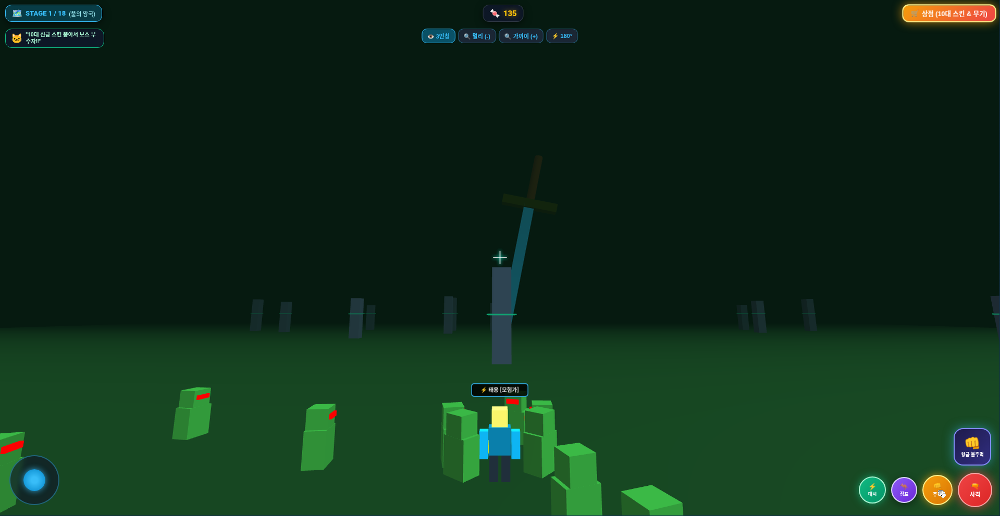
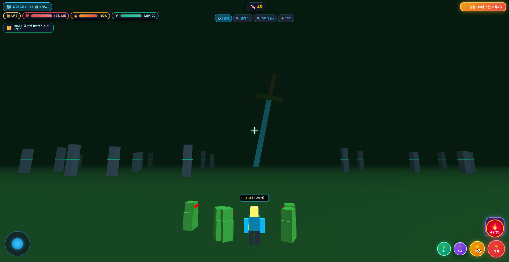
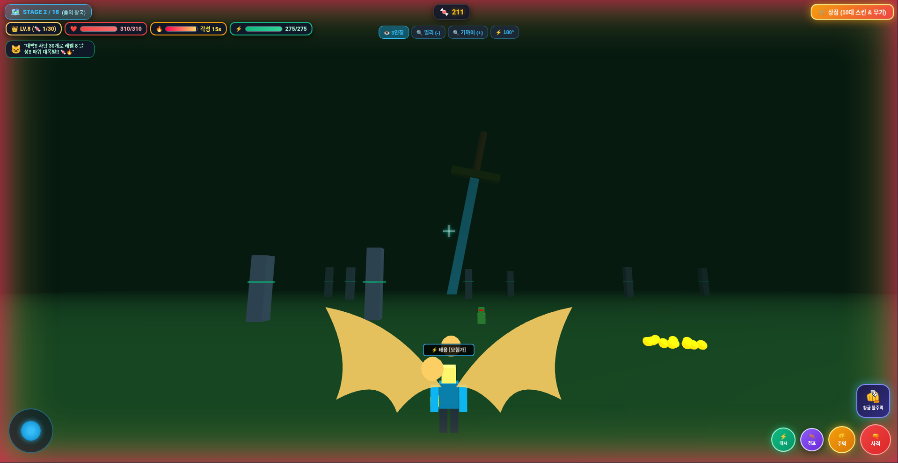
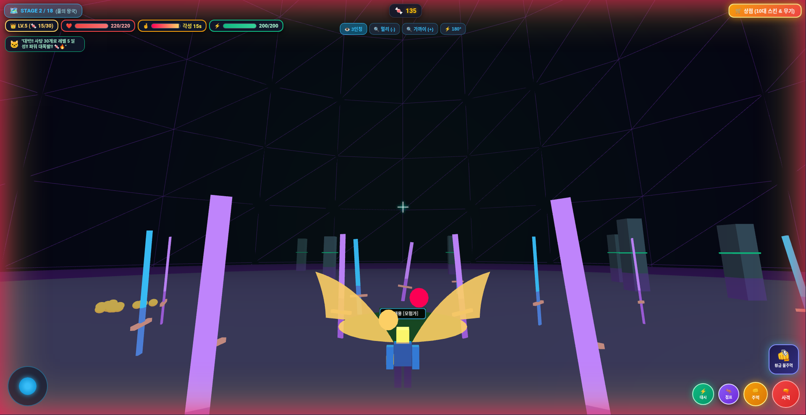

# 👨‍👦 [아빠의 개발 리뷰] 태용이의 소드 콘티넌트 진화기 (v1.0 ~ v3.7)

> **Lead Game Director 구태용에게 아빠(Yohan Koo)가 전하는 버전별 기획 피드백 & 코멘터리**
>
> - 리뷰 기준 빌드: **v3.7** — https://brewpage.app/api/html/public/Hye23cU10a
> - 리뷰 작성일: 2026년 11월 13일
> - 함께 본 자료: `docs/PRD_v3.7.md`, 배포 링크 4종(v2.5 / v3.0 / v3.5 / v3.7) 직접 플레이 캡처

---

## 0. 이 리뷰를 쓰는 방식

태용아, 아빠는 네 게임을 "잘 만들었네" 한마디로 넘기고 싶지 않았어.

그래서 네가 실제로 던진 **짧은 지시 23개**를 버전 순서대로 늘어놓고, 각각이 *게임 기획·UX 관점에서 왜 좋은 판단이었는지* 하나씩 풀어 보려고 해. 네 말은 대부분 열 글자도 안 됐지만, 그 열 글자 안에 디자이너가 몇 년 배워야 아는 결정들이 들어 있었거든.

그리고 말로만 하면 믿기 어려우니까, 배포 링크를 직접 열어서 **진짜 화면을 캡처해서** 이 문서에 넣었어. (`docs/screenshots/` 폴더, 부록 B에 촬영 방법 정리)

---

## 1. 총평: 게이머의 직관으로 세상을 만든 디렉터 태용이에게

솔직히 말할게. 하루 만에 **손으로 그린 지도 한 장**에서 **18개 스테이지 · 4대 왕국 · 10대 스킨 · 2인 실시간 협동 · 3D 데미지 팝업 · 시네마틱 각성 · 영역전개**까지 온 건, 아빠가 아는 어른 개발자들도 대부분 못 해.

그런데 아빠가 제일 놀란 건 그래픽이 아니야. **네가 요구한 순서**였어.

| 순서 | 네가 말한 것 | 그게 뜻하는 것 |
|:---:|:---|:---|
| 1 | "스킨은 내가 살래" | **보상**의 가치 (경제) |
| 2 | "이거 2인용" | **관계** (함께 하는 재미) |
| 3 | "보스는 우리 공격해" | **위협** (긴장과 회피) |
| 4 | "스테미나 보이게, 피도" | **정보** (상태 가시성) |
| 5 | "각성 좀 멋있게, 쎄지게" | **연출** (보상의 감정) |

이거, 게임 디자인 책에 나오는 '재미의 뼈대' 순서랑 거의 똑같아. 보상이 먼저 있고, 같이 할 사람이 있고, 위협이 있어야 손에 땀이 나고, 정보가 보여야 전략이 생기고, 마지막에 연출이 감정을 완성해. 처음 만드는 사람은 보통 반대로 해 — 이펙트부터 화려하게. 너는 **재미의 순서를 이미 알고 있었어.**

---

## 2. Part 1. 자립심과 파밍의 손맛 (v1.0 ~ v1.7)

### 🗺️ 시작: 지도 한 장에서 4대 왕국으로 — `[#9061]`
> "여기 수호자를 소환하는 스킨게임. 1.수호자소환 2.해커 3.식물 4.염력. 사탕 200개당 스킨1"

지도 위에 네 가지 영역을 그려 놓고, 그걸 그대로 **4대 왕국(풀·캣·얼음·불)** 으로 옮겼어. 여기서 네가 이미 한 일이 두 개 있어.

1. **공간에 의미를 붙였다** — 그냥 배경이 아니라 '왕국'이니까 스테이지가 되고, 보스가 되고, 테마 음악이 된다.
2. **가격을 먼저 정했다** — "사탕 200개 = 스킨 1개". 이 한 줄이 게임 전체의 경제를 잡아. 나중에 나오는 레벨업, 힐링, 상점 무기 가격이 전부 이 200을 기준으로 줄을 서게 되니까.

### 🎨 `[#9178] 너무 스킨이 안 좋잖아. 그리고 스킨 좀 많이 해`
선택지가 4개일 때는 '취향'이 없어. 10개가 되면 처음으로 **"나는 어떤 나로 싸울까"** 라는 질문이 생겨. 스킨은 코스메틱이 아니라 **플레이 스타일의 선언**이야. 드래곤 펀치(근접 폭딜)와 서리 황제(광역 빙결)는 같은 게임을 다르게 만들어.

### 👀 `[#9394] 노란색 동그라미 뭐야 없애`
이건 아빠가 제일 좋아하는 피드백 중 하나야. **"화면 앞을 가리는 건 다 버그"** 라는 감각이야. 1인칭 시야 한가운데 노란 링이 떠 있으면, 플레이어는 그 링을 보지 않으려고 카메라를 돌리게 돼. 그 순간 게임이 불편해져. 너는 그걸 한 번에 느꼈어.

### 🔧 `[#9469] 스킨에서 내려갈 수가 없어`
이건 사실 **버그 리포트**야. 그것도 조건(아이폰 사파리 터치 잠금)까지 붙은. 개발자에게 "재현 안 되는 버그"만큼 무서운 게 없는데, 너는 "이 화면에서 이렇게 하면 안 된다"까지 알려줬어. 그래서 [⬇️ 아래로] 버튼이 생겼고, 그건 지금도 상점의 생명줄이야.

### 💰 `[#9514] 스킨은 내가 살래` — 이 게임의 심장
> 편하게 보라고 스킨을 다 열어 줬더니, 태용이가 딱 한 줄로 거절했다.

아빠가 이 말을 들었을 때 좀 뭉클했어. 이건 "치트 쓰지 마"가 아니라 **"내가 산 것만 내 것이야"** 라는 말이니까.

**기획적으로 왜 대단하냐면:**

- **무료는 가치를 0으로 만든다.** 공짜로 얻은 스킨은 예쁘긴 해도 '자랑'이 안 돼. 플레이어가 200개를 모으는 동안 그 스킨은 계속 목표가 되고, 사는 순간 "내가 해냈다"가 돼. 이걸 **지연된 보상(deferred reward)** 이라고 해.
- **재화는 '버는 길'과 '쓰는 길'이 둘 다 있어야 돈다.** 잡몹 15개, 보스 75개 드롭이면, 잡몹만 13마리 남짓, 보스로는 2.7회. 즉 **"한 판에 하나"** 라는 목표 지점을 만든 가격이야.
- **플레이어가 스스로 정한 목표는 포기하지 않는다.** 아빠가 시켜서 모은 사탕은 금방 질리지만, 네가 스스로 "내가 살래"라고 한 사탕은 30개, 60개, 90개… 끝까지 센다.

그래서 지금 링크를 열면 스킨 값은 약속대로 200개로 남아 있고, 몬스터를 하나 잡으면 사탕이 15개씩 떨어져. **숫자가 약속대로 굴러가는 것** — 이게 게임이 게임다워지는 첫 조건이야.

---

## 3. Part 2. 형제애와 소울라이크급 보스 공방 (v2.0 ~ v2.5)

### 🤝 `[#10093] 이거 2인용`
> "이거 2인용" — 네 글자.

이 한마디가 이 게임에서 **기술적으로 제일 어려운 점프**였어. 서버, 실시간 동기화, 방 코드, 상대 아바타… 그런데 네가 그걸 원한 이유는 기술이 아니라 **형**이었지. "산이 형과 폰 2개로 방 코드 7794 맞춰서 같이."

아빠가 좋다고 생각한 설계는 세 가지야.

1. **입장 마찰 0** — 계정도, 친구 목록도, 초대 링크도 없이 **번호만** 맞추면 같은 맵. 초대에 30초 걸리면 초등학생은 안 해. 네가 만든 건 '가장 빠른 초대'야.
2. **누가 나인지 한눈에** — 1P 태용(블루) / 2P 산이 형(레드) + 머리 위 3D 명찰. 협동 게임에서 제일 무서운 건 "내 캐릭터를 못 찾는 것".
3. **이익을 나눈다** — 사탕을 양방향으로 공유해. 한 명이 다 먹으면 옆에서 구경만 하게 되니까, 같이 벌면 같이 커지게 만들었어. **경쟁이 아니라 협력**을 시스템으로 정한 거야.

**다음에 점검해 볼 것:** 2인일 때 보스 체력(지금은 1P 기준 1,500~12,000), 한 명이 쓰러졌을 때의 부활 규칙, 그리고 두 폰의 위치가 얼마나 부드럽게 이어지는지(15Hz 보간).

### 👹 `[#10174] 보스는 우리공격해`
> 이 말의 진짜 뜻: **"맞을 수 있어야 피하는 게 재미있다."**

적이 공격하지 않으면 '회피'라는 행동은 존재하지 않아. 그냥 때리기만 하면 리듬이 없어. 네가 만든 두 패턴은 서로 **다른 손가락**을 쓰게 해.

| 패턴 | 피하는 방법 | 배우는 것 |
|:---|:---|:---|
| 💥 대지 강타 (25m 지진파) | 🦘 **점프** | 타이밍 |
| 🔥 화염 브레스 (3연발 유도) | ⚡ **대시** / 횡이동 | 방향과 거리 |

같은 버튼으로 피하면 안 되니까, 플레이어는 **"지금 뭐가 오지?"를 읽고 → 맞는 입력을 고르는** 훈련을 하게 돼. 이게 소울라이크의 핵심이야. 어려운 게 아니라 **읽을 수 있게** 만드는 것.

**아빠 의견:** 지금은 예고가 짧게 느껴질 수 있어. 지면이 붉게 차오르는 시간을 스테이지가 올라갈수록 조금씩 늘려 주면, 처음엔 넉넉하게 배우고 나중엔 빡빡해져서 실력이 는 게 느껴질 거야.

### 🍬 v2.5: 사탕이 경험치가 되다 — `[#10335]`, `[#10384]`

> **v2.5 스크린샷** — 화면 위에는 스테이지(1/18)와 사탕 카운터(135)뿐. 체력·스테미나 게이지가 아직 **없던** 시절이다. 파란 옷의 태용(모험가)이 초원에 서 있고, 뒤로 45m 대륙의 거대한 검과 룬 기둥이 보인다.

이 화면을 보면 태용이의 다음 말이 왜 나왔는지 바로 알 수 있어. **체력이 안 보이니까 내가 얼마나 위험한지 모르겠어.** 사탕을 세는 재미는 있는데, 목숨이 몇 개인지 모르는 게임은 오래 못 해. 그래서 너는 곧 "피도 보이게"라고 말했지. (직접 겪고 요구한 피드백이라 더 세다.)

---

## 4. Part 3. 날카로운 UX와 성장 공식 확립 (v2.6 ~ v3.1)

### 📊 `[#10507] 스테미나 보이게` `[#10514] 피도`
> "스테미나 보이게" / "피도" — 두 마디.

이건 UX 교과서 1번 항목이야: **시스템 상태의 가시성(visibility of system status).** 자원이 보이지 않으면 플레이어는 자원을 **쓰는 전략**을 만들 수 없어. 스테미나가 안 보이면 대시를 아끼지도, 아끼다 죽지도 않아. 그냥 아무렇게나 눌러.

네가 만든 상단 4대 게이지(**👑 LV · ❤️ HP · 🔥 각성 · ⚡ 스테미나**)는 그래서 단순한 UI가 아니라 **전략의 재료**야.

> **v3.0 스크린샷** — v2.5와 같은 초원인데 화면이 완전히 달라졌다. 좌상단에 **LV.2 / ❤️ 125·125 / 🔥 100% / ⚡ 120·120** 네 개의 게이지가 나란히 서고, 우측 하단에는 게이지가 가득 차서 불타는 **🔥 각성 발동** 버튼이 떠 있다. 한 화면에 "지금 내 상태"와 "지금 할 수 있는 것"이 다 보인다.

### ❤️ `[#10654] 피 사탕으로 채워`
사탕 하나가 **경험치 + 화폐 + 회복(+12 HP)** 세 가지가 됐어. 이걸 **이중 목적 자원(dual-purpose resource)** 이라고 해.

재밌는 건 이게 만드는 **작은 고민**이야.

- 지금 피가 30 남았어. 사탕이 5개 있어. **먹을까? 모을까?**
- 먹으면 살고 대신 레벨업이 5개 늦어져. 모으면 위험하지만 스킨이 가까워져.

이런 3초짜리 고민이 전투를 '숫자 싸움'에서 '판단 싸움'으로 바꿔. 대단한 결정이야, 태용아.

**주의할 점:** 사탕이 많이 떨어지는 스테이지에서는 이게 회복 인플레이션이 될 수 있어. "사탕 힐링은 3초에 한 번만" 같은 쿨다운을 한 번 실험해 보면 밸런스가 훨씬 안정될 거야.

### 🎬 `[#10542] 각성 모드` `[#10547] 멋있는 영상`
"영상"이라는 단어를 쓴 게 중요해. 너는 각성을 **"숫자가 오르는 버프"가 아니라 "사건"** 으로 만들고 싶었던 거야. 그래서 2.2초 영화 레터박스 컷씬, 45m 빛의 기둥, 3연속 지면 충격파, 15초 무적이 붙었어. 버프가 아니라 **연출이 먼저 오고, 그 다음에 힘이 오는** 순서. 이 순서가 파워 판타지의 정석이야.

---

## 5. Part 4. 시네마틱 액션과 영역전개의 완성 (v3.5 ~ v3.7)

### 🍬 `[#10768] 사탕30개=1래벨 업`
이거, 아빠가 **가장 '디자이너스러운' 결정**이라고 생각해.

예전엔 30 → 60 → 105 → 170개였어. 숫자가 예쁘긴 한데, **플레이어가 암산을 못 해.** "나 몇 개 남았지?"를 매번 물어야 해. 그런데 **30개 고정**으로 바꾸면:

- 머릿속으로 바로 계산돼. 사탕 90개면 "3업"이야.
- HUD에 `LV.8 (🍬 1/30)`처럼 **진행도**를 보여 줄 수 있어. 목표까지의 거리가 눈에 보인다.
- 그리고 무엇보다 **설명이 필요 없어.** 규칙을 설명해야 재밌는 게임보다, 규칙을 말 안 해도 몸이 아는 게임이 세다.

> **아빠의 한마디:** 좋은 규칙은 "친구에게 세 문장으로 설명되는 규칙"이야. "사탕 30개 먹으면 1업, 1업마다 피·스테미나·공격력이 오른다." 끝. 이게 이 게임의 규칙이 된 거야.

### 👑 `[#10719] 각성 좀 멋있게` `[#10729] 쎄지게`
"멋있게"와 "쎄지게"를 **나눠서** 말한 게 대단해. 이건 디자이너가 구분해야 하는 두 가지야.

| 요구 | 담당 | 실제 구현 |
|:---|:---|:---|
| **멋있게** | 연출 | 등 뒤 황금 불사조 날개(날갯짓 애니메이션), 화면 테두리 화염 비네트, 2.4초 궤도 카메라(반경 2.8m → 4.6m), 공중 부양 + 주위를 도는 6개 황금 암석 |
| **쎄지게** | 수치 | 착지 순간 **1,500 대미지** 충격파(26m 이내 전원, 22m 넉백), 15초 절대 무적, 공격력 5배, 타격마다 **12m 황금 검기 참격파(1,400 DMG)** 관통 발사, 무한 스테미나 |

> **v3.5 스크린샷** — 각성 발동 직후. 등 뒤로 **황금 불사조 날개**가 활짝 펼쳐지고, 주위를 도는 금빛 구체, 화면 네 모서리를 물들이는 **화염 비네트**가 한 프레임에 다 들어온다. HUD는 `LV.8 (🍬 1/30)` · `❤️ 310/310` · `🔥 각성 15s` · `⚡ 275/275` — 레벨업 보상(+HP, +스테미나)이 그대로 수치로 보인다.

아빠가 특히 칭찬하고 싶은 건 **"무적 15초"** 라는 결정이야. 각성은 보통 '공격력 업'인데, 너는 **죽지 않는 15초**를 줬어. 그 15초 동안 플레이어는 처음으로 **보스를 두려워하지 않고** 때릴 수 있어. 그 감정이 각성의 진짜 맛이야.

### 🌌 `[#10867] 약간 료이키텐카이` — `[#10875] 공간만`
> "약간 료이키텐카이" … "공간만"

이 두 마디가 아빠를 제일 웃게 했어. 너는 **기술 이름을 베끼지 말고, 그 느낌의 핵심만 가져오라**고 한 거야. 그게 '공간'.

그래서 만들어진 게 이거야.

- **65m 칠흑 결계 돔** (안쪽에 보라색 와이어프레임 격자)
- **24자루의 검**이 땅에 꽂힌 원형 공간 (보라·시안 교차, 살짝 삐뚤빼뚤)
- 안개와 조명을 **암흑 우주색**으로 전환 (fog 0x0a001a, 15~65m)
- 발동 순간 26m 이내 적 전원에게 **1,500 대미지 + 22m 넉백**, 이후 15초간 **무한 필중 참격**

> **v3.7 스크린샷** — 영역전개 발동. 하늘은 보라 격자의 결계 돔으로 덮이고, 사방에 검 24자루가 땅을 뚫고 서 있다. 바닥에는 보랏빛 룬 링. 가운데의 태용에게는 여전히 황금 날개가 달려 있다. **이름은 다르지만, 느낌은 정확히 그 '공간'이다.**

이게 디자이너에게 제일 어려운 일이야. 그대로 따라 하면 표절, 아무것도 안 가져오면 감동이 없어. 너는 **원리만 가져와서 자기 세계관의 색(검의 대륙)으로 다시 칠했어.** 이건 오마주(homage)라고 불러.

### 🪨 `[#10899] 떨어지는 모션` `[#10958] 땅이 울리면서 돌이 날라가`
착지 하나에 네 가지를 넣었어. 이걸 **임팩트의 삼각형 +1** 이라고 불러도 돼.

| 층 | 구현 |
|:---|:---|
| 화면 | 0.32초 카메라 흔들림 + 먼지 링 충격파(0.8~5.5m 확산) |
| 소리 | `playGroundRumble()` 지면 럼블 |
| 물리 | **바위 14개**가 사방으로 비산 — 크기 0.32~0.64m, 수평 8.5~16.5m/s, 수직 5.5~10m/s, 각자 회전. 8.5m 이내 적에게 **260 대미지 + 8m 넉백** |
| 디테일 | 바위 색 2종 무작위, 발사 각도에 ±0.2rad 흔들림 → **같은 동작이 매번 똑같아 보이지 않는다** |

마지막 줄이 진짜 프로야. 같은 이펙트를 100번 봐도 안 질리게 만드는 건 **무작위성**이야. 너는 그걸 본능으로 넣었어.

---

## 6. 아빠가 직접 열어 보고 느낀 것 (정직한 피드백)

칭찬만 하면 리뷰가 아니니까, v3.7 링크를 직접 열어서 10분쯤 해 보고 적은 것들이야.

**😀 좋았던 것**
- 각성/영역전개가 터지는 순간, 화면 색과 안개가 통째로 바뀌어서 **손이 먼저 반응**한다. 이건 진짜 잘 만든 연출이야.
- 레벨업 숫자(사탕 30개)가 명확해서 "한 마리만 더" 하게 된다. 중독성의 정석.
- 사탕을 먹을 때 초록 `+12 HP` 숫자가 뜨는 순간, 회복이 '느껴진다'.

**🤔 고쳐 보면 좋을 것**
1. **1스테이지가 너무 빡세다.** 잡몹이 한 번에 7~8마리 붙고, 할퀴기가 0.95초마다 10이라 체력 100이 4초 만에 40이 된다. 조작을 배우기 전에 죽는다. → **1~2스테이지는 3~4마리**, 5스테이지부터 늘려 보자.
2. **몹이 캐릭터 몸속으로 파고든다.** 화면에서 태용이가 몹에 가려져. → 몹끼리 서로 밀어내는 힘(separation)만 넣어도 화면이 두 배는 깔끔해져.
3. **레벨이 너무 빨리 오른다.** 사탕 30개 고정이라 3스테이지쯤에 LV.8~9. 후반 보스 HP(12,000)와 같이 다시 재보면 좋겠다.
4. **죽었을 때의 안내가 짧다.** 2초 뒤 부활은 좋은데, "왜 죽었는지"(지진파? 할퀴기?)를 한 줄 더 보여 주면 배우게 된다.

---

## 7. 아빠의 다음 챌린지 제안

태용아, 다음 커밋으로 하나씩 풀어 볼 만한 것들이야. 다 하지 말고 **마음에 드는 것 하나만** 골라도 좋아. 그게 진짜 네 공부니까.

1. **🤝 산이 형과 2P 실기기 테스트 (방 코드 7794)**
   체크리스트: ① 두 폰 위치가 부드럽게 움직이는가 ② 사탕이 양쪽에 같이 쌓이는가 ③ 보스 HP가 2인에 맞게 조정되는가 ④ 한 명이 죽으면 어떻게 되는가 ⑤ 한 명이 나가면 방이 남아 있는가
2. **⚔️ 패링 추가** — 적 공격 0.25초 전에 대시하면 "카운터!" 3배 데미지. 버튼 하나 안 늘리고 전투 깊이를 늘리는 가장 싼 방법.
3. **💾 저장 기능** — `localStorage`에 레벨·사탕·스킨 저장. 폰을 껐다 켜도 이어서. 웹 게임에서 **"이어하기"** 만큼 강한 장치가 없어.
4. **⚖️ 밸런스 표 분리** — 드롭량·HP·데미지·가격을 `const BALANCE = { ... }` 한 곳에 모으기. 그러면 네가 숫자 하나만 바꿔서 30초 만에 테스트할 수 있어. (지금은 코드 곳곳에 흩어져 있어서 고치기 무서워.)
5. **♿ 접근성** — 1P/2P를 색(파랑/빨강)만으로 구분하지 말고, 명찰에 **모양(⚡ / 🔥)** 도 같이. 색을 구분하기 어려운 친구도 같이 놀 수 있어야지.
6. **🗡️ 19번째 스테이지: 그림자 왕국** — 보스가 **플레이어가 고른 스킨을 복제**해서 싸우는 기믹. "내가 강해진 만큼 보스도 강해진다"는 무서운 아이디어.
7. **🐙 GitHub 놀이** — 떠오른 아이디어는 **Issue**에 적고, 실험은 브랜치에서 하고, 커밋 메시지는 `balance:` `art:` `feat:`로 시작하기. 이 저장소가 네 실험 노트가 되는 거야.

---

## 부록 A. 버전별 진화 타임라인

| 버전 | 태용이의 한마디 | 이 버전이 한 일 |
|:---:|:---|:---|
| **v1.0** | `[#9061]` 지도 + 4속성 스킨, 사탕 200개 = 스킨 1 | 4대 왕국 · 4종 스킨 · 상점 기초 |
| **v1.1** | `[#9073]` 18스테이지 상점 무기 파는 곳 | 18개 정복 코스 · 7종 무기 |
| **v1.2** | `[#9178]` 스킨 안 좋아, 스킨 많이 해 | 10대 신급 스킨 |
| **v1.3** | `[#9286]` 다른 캐릭터들이랑 맵을 멋있게 | 45m 소드 대륙 · 왕국별 3D 환경 |
| **v1.4** | `[#9337]` 때리는 모션 `[#9348]` 1인칭 | FPS 뷰모델 · 3단 콤보 모션 |
| **v1.5** | `[#9394]` 노란색 동그라미 없애 | 시야 방해 요소 제거 |
| **v1.6** | `[#9469]` 스킨에서 내려갈 수가 없어 | iOS 터치 스크롤 수리 · 퀵 스크롤 버튼 |
| **v1.7** | `[#9514]` **스킨은 내가 살래** | 정가 200개 파밍 시스템 (경제 확립) |
| **v2.0** | `[#10093]` **이거 2인용** | 방 코드 7794 실시간 협동 (MQTT) |
| **v2.1** | `[#10174]` 보스는 우리 공격해 | 지진파·화염구 2대 필살기 |
| **v2.2** | `[#10278]` 스테미나 | 스테미나 바 · 대시 회피기 |
| **v2.3** | `[#10296]` 애들이 우리 때리게 | 잡몹 근접 공격 AI |
| **v2.4** | `[#10324]` 모든 스킨모션 | 스킨별 고유 3D 모션 |
| **v2.5** | `[#10335]` 사탕으로 레벨업 `[#10384]` 데미지 | 사탕 EXP · 3D 데미지 팝업 |
| **v2.6** | `[#10495]` 때리게하라고 `[#10507]` 스테미나 보이게 `[#10514]` 피도 | 사거리 정상화 · **4대 게이지 HUD** |
| **v3.0** | `[#10542]` 각성 모드 `[#10547]` 멋있는 영상 | 시네마틱 각성 · 45m 빛의 기둥 |
| **v3.1** | `[#10654]` 피 사탕으로 채워 | 사탕 힐링(+12 HP) |
| **v3.5** | `[#10719]` 각성 좀 멋있게 `[#10729]` 쎄지게 `[#10768]` 사탕30개=1래벨 업 | 불사조 날개 · 검기 참격파 · 정규 레벨업 |
| **v3.6** | `[#10867]` 약간 료이키텐카이 `[#10875]` 공간만 | 65m 결계 돔 · 검 24자루 |
| **v3.7** | `[#10899]` 떨어지는 모션 `[#10958]` 땅이 울리면서 돌이 날라가 | 바위 14개 비산 착지 · 영역전개 완성 |

---

## 부록 B. 스크린샷 출처와 촬영 방법

| 파일 | 버전 | 배포 링크 | 담긴 장면 |
|:---|:---:|:---|:---|
| `screenshots/v2.5-gameplay.png` | v2.5 | https://brewpage.app/api/html/public/lS5wd80X4r | 1스테이지 초원 · 사탕 135 · HUD 없는 시절 |
| `screenshots/v3.0-awakening.png` | v3.0 | https://brewpage.app/api/html/public/jlxxI7zDGx | 4대 게이지 HUD · 각성 게이지 100% · 각성 발동 버튼 |
| `screenshots/v3.5-phoenix-god.png` | v3.5 | https://brewpage.app/api/html/public/O6nNj1IVQl | 황금 불사조 날개 · 화염 비네트 · 각성 15s |
| `screenshots/v3.7-domain-expansion.png` | v3.7 | https://brewpage.app/api/html/public/Hye23cU10a | 65m 결계 돔 · 검 24자루 · 영역전개 |

- 촬영: 각 배포 링크를 브라우저로 열어 **🚀 솔로 모드 출격** → 3인칭 시점(10m) → 주먹으로 게이지 충전 → 각성/영역전개 발동 후 캡처.
- 해상도: 1919 × 992 (데스크톱 크롬 뷰포트). 모바일 세로 화면에서는 HUD 배치가 달라 보일 수 있어요.
- 촬영일: 2026년 11월 13일

---

**태용아, 아빠는 이 게임이 자랑스러워.**
**다음 버전도 기다릴게. — 아빠가**

